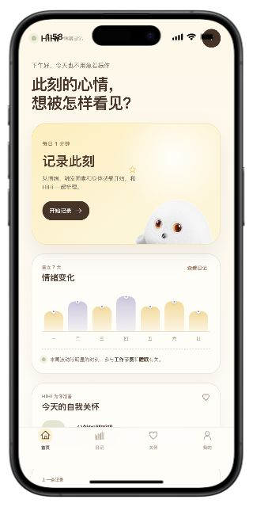

# 👋 Hi, I'm Hui Yao / 惠尧

> **Creative AI Product Builder** · Agent 交互 · 模型评测 · 数据分析 
> 把用户洞察转化为可体验、可验证的 AI 产品。

[个人作品集](https://yaohui.me/) · [GitHub](https://github.com/HuiYaoooo) · [LinkedIn](https://www.linkedin.com/in/yao-hui-4b690834b/) · [Email](mailto:huiyao0607@sjtu.edu.cn)

## 🧑‍💻 About Me

我是惠尧，具有设计与数据分析的交叉背景，曾在得物、智慧树参与 AI 导购助手和知识库产品建设。现在专注于 Agent 对话体验、评测流程与数据验证，通过情绪陪伴、情绪日记和可持续发展研究项目，探索 AI 如何解决具体问题。工作之外，喜欢用摄影记录旅行中的建筑、天气与途中片刻。

## 🛠 Skills

**产品方向**：Agent 交互策略、对话体验设计、模型评测、知识生产与质量评测流程。 
**研究与分析**：数据分析、数据建模、可视化，以及通过实验与数据验证产品策略。

**项目实践工具**

## 🚀 Featured Projects

<table>
  <tr>
    <td width="210" align="center">
      
    </td>
    <td>
      <h3>情绪日记 · 从觉察情绪到照顾自己</h3>
      
从情绪强度、触发因素和身体感受出发，帮助用户记录当下，并通过日记时间线、七日趋势和自我关怀建议梳理变化。

      
<strong>我的工作：</strong>独立完成产品设计、开发与部署。

      
<a href="https://hihi-mood-journal.yaoohui2.chatgpt.site/">体验 Demo ↗</a> · <a href="https://yaohui.me/#project-page-mood">项目介绍</a>

    </td>
  </tr>
  <tr>
    <td align="center">
      
    </td>
    <td>
      <h3>HiHi · AI 驱动的情绪化饮食陪伴系统</h3>
      
围绕独自进餐与情绪化饮食，探索 AI 萌宠陪伴、进餐互动与记忆日历，让一次用餐成为有回应的日常体验。

      
<strong>我的工作：</strong>核心成员，独立搭建交互 Demo。 <strong>项目成果：</strong>食品可持续赛道 TOP1。

      
<a href="https://yaohui.me/hihi-demo/">体验 Demo ↗</a> · <a href="https://github.com/HuiYaoooo/my-portfolio/tree/main/hihi-demo">查看代码</a> · <a href="assets/project_hihi_friends.pdf">项目资料</a>

    </td>
  </tr>
  <tr>
    <td align="center">
      
    </td>
    <td>
      <h3>东南亚塑料废弃物研究平台</h3>
      
面向 ASEAN-10，将 2014–2024 年废塑料双边贸易、2022 年来源与材料归因，以及物质流研究结果组织成可交互的研究平台。

      
<strong>我的工作：</strong>独立研究、数据建模与可视化，将复杂数据转化为可探索的跨境路线与材料流动。

      
<a href="https://plasticwastedata.org/">探索平台 ↗</a> · <a href="https://yaohui.me/#project-page-research">研究介绍</a>

    </td>
  </tr>
</table>

## 📊 GitHub Activity

  
  

动态卡片由 [GitHub Profile Summary Cards](https://github.com/vn7n24fzkq/github-profile-summary-cards) 生成；[查看 GitHub 个人主页](https://github.com/HuiYaoooo)。

## 📬 Contact

欢迎交流 AI 产品、研究合作与新的机会。

- **Portfolio**：[yaohui.me](https://yaohui.me/)
- **LinkedIn**：[Hui Yao](https://www.linkedin.com/in/yao-hui-4b690834b/)
- **Email**：[huiyao0607@sjtu.edu.cn](mailto:huiyao0607@sjtu.edu.cn) · [yaoohui2@gmail.com](mailto:yaoohui2@gmail.com)
- **Photography**：[Fragments in Transit](https://yaohui.me/#photography)

---

关于这个作品集网站的本地运行、内容维护与发布，见 [开发与部署说明](docs/DEVELOPMENT.md)。
